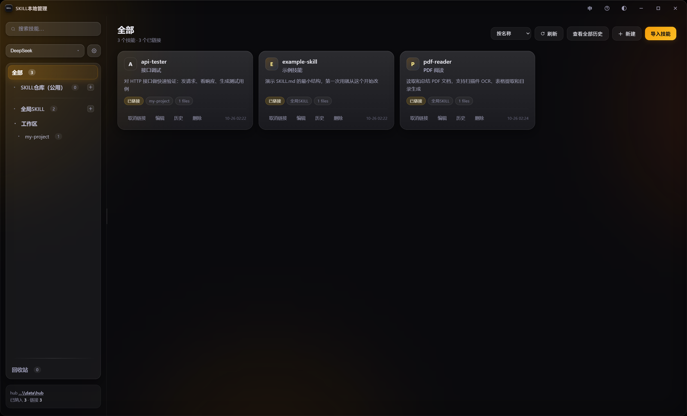
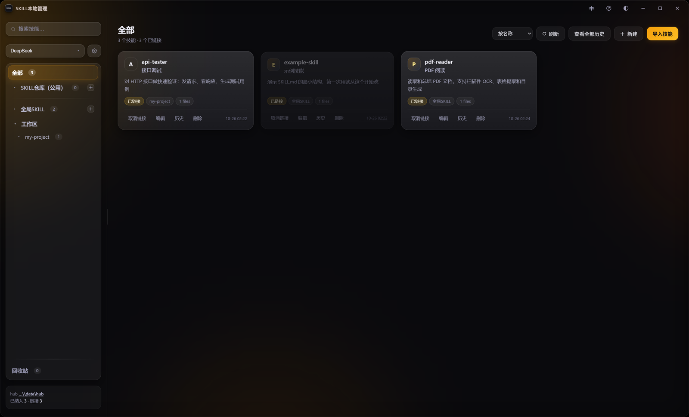
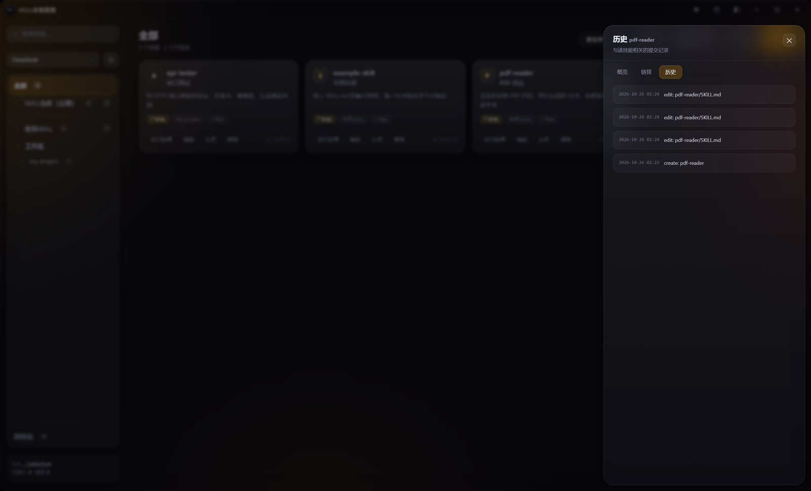

# skill-profiles

> 管理 AI 编码助手的 **Skills**，一处编辑、链接分发。
> 支持 DeepSeek Harness / Claude Code / Codex / Cursor / Windsurf / Cline。

**作者：Zijing** · [GitHub](https://github.com/zijing9) · [MIT 许可](LICENSE)

同一份技能文件，可以让多个工具同时用——不用复制，靠目录链接。改一处，所有挂载点同时生效。

---

## 它解决什么

AI 编码助手的技能（`SKILL.md`）通常散落在各个工具目录里：

```
~/.dsh/skills/xxx          ← DeepSeek Harness 用
~/.claude/skills/xxx       ← Claude Code 用
~/.codex/skills/xxx        ← Codex 用
项目/.dsh/skills/xxx        ← 某个项目专用
```

想改一个技能，得改四份；想停用，得删四处。

**skill-profiles 的做法**：技能只存一份，需要的地方放一个链接。

```
data/hub/skills/example-skill/     ← 真身（唯一）
~/.dsh/skills/example-skill        → 链接
~/.claude/skills/example-skill     → 链接
```

---

## 能做什么

| 功能 | 说明 |
|---|---|
| **统一仓库** | 所有技能存一份，靠链接分发到各工具、各工作区 |
| **版本历史** | 每次改动自动一条 git commit，可看 diff、可回滚、可找回删除的技能 |
| **回收站** | 删除先进回收站，10 天内随时恢复 |
| **技能分身** | 同一技能拆多份给不同工具，可同步或独立发展 |
| **多工具支持** | 6 家主流工具，自动探测目录（含环境变量） |
| **内容审计** | `skill audit` 检查提示词注入、危险命令、凭据外发 |
| **中英双语** | 界面右上角切换 |
| **命令行** | 18 条命令，JSON 输出，agent 可直接调用 |

---

## 截图

非常好用，截图能展示的内容非常有限。自己用着很爽，就直接做成完整开源了。左侧导航栏很好用。

每个 agent 都有自己的页面，同时共用一个仓库。可以在仓库里复制多份，然后在想添加 skill 的
agent 页面，把其中一份拖过去——这样同一个 skill 就能给不同的 agent 用。可以各自改各自的，
也可以同步修改，删除也可以一起删除。功能都是想着怎么用着舒服怎么加的。

技能的创建、编辑、挂载、删除、回滚，基本都能在界面里完成。
也做了 CLI，agent 可以直接调用。还有不少功能没列出来，估计也有不少 bug，欢迎提 issue。



拖动卡片到左侧目标位置，会先说明「原位置的链接会被移除」，确认后才移动：



每次改动自动提交 git，可看历史、对比差异、回滚到任意版本：



## 系统要求

| 项 | 要求 |
|---|---|
| 系统 | **Windows 10 / 11**（用到了 NTFS 目录链接，暂不支持 macOS/Linux） |
| Python | 3.9 或更高 |
| WebView2 | Windows 10/11 已内置；旧系统需[单独安装](https://developer.microsoft.com/microsoft-edge/webview2/) |

---

## 安装

```powershell
git clone https://github.com/zijing9/skill-profiles.git
cd skill-profiles

# 一键装依赖（会自动找 Python）
.\install.ps1

# 或者手动
pip install -r requirements.txt
```

`install.ps1` 会检查 Python 版本、装依赖、验证三个包能否 import。加 `-AddToPath` 可把 `skill` 命令加进 PATH。

---

## 快速开始

```powershell
# 双击 启动.vbs（无控制台）
# 或
python app.py
```

**首次启动会走一遍引导**：

1. 弹一份 18 步的功能导览（可跳过，右上角 `?` 随时重开）
2. 确认后扫描本机，发现你装了哪些工具
3. 让你选「工作区父目录」（放项目的那个根目录）
4. 如果发现已有技能散在各处，问你要不要纳管进仓库

纳管时会做四件事：复制进仓库 → 校验完整性 → 删原目录 → 在原位置建链接。任何一步失败都会回滚。

---

## 核心概念

### 实体 vs 链接

| | 位置 | 说明 |
|---|---|---|
| **实体** | `data/hub/skills/<技能名>/` | 真身，唯一一份，带 git 历史 |
| **链接** | `~/.dsh/skills/<技能名>` 等 | 指向实体，Windows 上是 junction |

删链接不影响实体；删实体前会先断开所有链接。

### 三个位置

| 界面上的名字 | 磁盘上的位置 | 含义 |
|---|---|---|
| **SKILL仓库（公用）** | `data/hub/skills` | 暂不用的技能放这里，所有工具看不到 |
| **全局SKILL** | `<用户目录>/.dsh/skills`（按当前 agent 变） | 挂到这里对所有项目生效 |
| **工作区** | `<工作区>/.dsh/skills` | 只对该工作区生效 |

### 检测范围

只检测**两层**：

- 全局：`<用户目录>/.dsh/skills`
- 工作区：`<工作区>/.dsh/skills`

**不检测**：工作区内部按项目分的子目录、更深层嵌套、项目级技能。完整规则见 [检测规范.md](检测规范.md)。

工作区的判定和目录名无关——只看「子目录里有没有 `<工具>/skills`」。

---

## 支持的工具

| 工具 | 全局目录（按顺序探测） | 工作区 |
|---|---|---|
| DeepSeek Harness | `~/.dsh/skills`、`~/.agents/skills` | `.dsh/skills` |
| Claude Code | `$CLAUDE_CONFIG_DIR/skills`、`~/.claude/skills` | `.claude/skills` |
| Codex | `$CODEX_HOME/skills`、`~/.codex/skills` | `.codex/skills` |
| Cursor | `~/.agents/skills`、`~/.cursor/skills` | `.cursor/skills` |
| Windsurf | `~/AppData/Roaming/Windsurf/rules`、`C:/ProgramData/Windsurf/rules` | `.windsurf/rules` |
| Cline | `~/.cline/rules` | `.cline/rules` |

路径不匹配可以在设置里手动改。Windsurf / Cline 用的是 rules 格式（`<名>/<名>.md`），只能识别，不能直接当 `SKILL.md` 挂载。

---

## 命令行

```powershell
python cli\skill.py --help          # 全部命令
python cli\skill.py detect          # 检测全局与工作区
python cli\skill.py list --status unlinked
python cli\skill.py create my-skill --zh 中文名 --desc "什么时候用" --link global --yes
python cli\skill.py audit --human   # 内容安全审计
python cli\skill.py history my-skill
python cli\skill.py rollback my-skill --commit 1a2b3c4d --yes
```

18 条命令，默认输出 JSON，写操作要 `--yes`，都支持 `--dry-run`。

**agent 可以直接调用**：完整契约见 [cli/cli.spec.json](cli/cli.spec.json)，用法见 [cli/README.md](cli/README.md)。

## 已知限制

- **仅 Windows**：依赖 NTFS 目录链接。跨平台需要改 `core/platform.py` 一个文件（链接操作已收敛），但没环境验证。
- **不检测项目级技能**：工作区里按项目分的子目录不扫（见检测规范）。
- **不翻译技能内容**：界面中英双语，但技能名/描述/SKILL.md 是用户数据，原样显示。
- **单实例**：靠全局互斥量，同机不能同时开两个副本。
- **Windsurf / Cline 只读**：rules 格式不同，能识别不能挂载。

---

## 参与开发

欢迎提 Issue 和 PR。开发约定、环境配置和测试方法见 [CONTRIBUTING.md](CONTRIBUTING.md)。

## 许可证

[MIT](LICENSE) © 2026 Zijing
