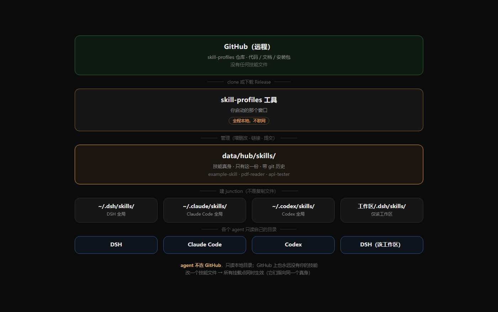

# 关系图：agent、技能、GitHub

> 一句话：**GitHub 上只有工具的代码，没有你的技能；你的技能只在本地，由本工具统一管理。**



---

## 一、全景

```
┌──────────────────────────── GitHub（远程） ────────────────────────────┐
│                                                                        │
│   skill-profiles 仓库              Releases                            │
│   ├─ app.py / cli/ / static/       └─ v1.0.0 安装包 zip                │
│   ├─ README / 文档                                                     │
│   └─ 不含任何技能                                                       │
│                                                                        │
└───────────────────────────┬────────────────────────────────────────────┘
                            │ clone 或下载 zip
                            ▼
┌──────────────────────────── 你的电脑 ──────────────────────────────────┐
│                                                                        │
│   ┌──────────────────────┐                                             │
│   │  skill-profiles 工具 │  ← 你启动的那个窗口                          │
│   └──────────┬───────────┘                                             │
│              │ 管理（增删改、链接、提交）                                │
│              ▼                                                         │
│   ┌──────────────────────────────────┐                                 │
│   │  data/hub/skills/                │  ← 技能真身，只有这一份          │
│   │  ├─ example-skill/               │    + git 版本历史               │
│   │  ├─ pdf-reader/                  │                                 │
│   │  └─ api-tester/                  │                                 │
│   └────┬─────────┬─────────┬─────────┘                                 │
│        │ junction│junction │junction                                   │
│        ▼         ▼         ▼                                           │
│   ~/.dsh/    ~/.claude/  <工作区>/.dsh/                                 │
│   skills/    skills/     skills/                                       │
│        │         │         │                                           │
│        ▼         ▼         ▼                                           │
│   ┌────────┐ ┌──────────┐ ┌──────────┐                                 │
│   │  DSH   │ │ Claude   │ │  DSH     │  ← 这些程序读自己目录里的内容   │
│   │        │ │  Code    │ │（工作区）│                                 │
│   └────────┘ └──────────┘ └──────────┘                                 │
│                                                                        │
└────────────────────────────────────────────────────────────────────────┘
```

**读法**：

- 上半部分是 GitHub，只放**工具的代码**
- 下半部分是你的电脑，技能都在这里
- 中间那层 `~/.dsh/skills` 等目录里，装的是**指向 hub 的链接**（不是副本）
- 最底下的 agent 只认自己目录，不知道 hub 存在

---

## 二、关键：agent 不连 GitHub

很多人会以为「agent 从 GitHub 拉技能」。**不是的。**

| 谁 | 连什么 | 说明 |
|---|---|---|
| **skill-profiles 工具** | 本地文件 + 本地 git | 不联网也能用 |
| **你的 AI 助手（DSH 等）** | 只读本地 `~/.dsh/skills` 等 | 不知道 GitHub 存在 |
| **GitHub** | 只存工具的代码 | 你的技能永远不上传 |

所以：

```
GitHub ──(下载工具)──> 你的电脑 ──(技能)──> AI 助手
                          ↑
                     不往回传技能
```

---

## 三、三套 git，互不干扰

| 仓库 | 在哪 | 管什么 | 会上传 GitHub 吗 |
|---|---|---|---|
| **工具代码** | 项目根 `.git` | app.py、文档 | ✅ 会（就是 GitHub 上那个） |
| **技能内容** | `data/hub/.git` | 每个技能每次改动 | ❌ 不会（`.gitignore` 排除） |
| **GitHub 远程** | github.com/zijing9/skill-profiles | 工具代码的一份备份 | — |

**所以：改技能不会推到 GitHub，改代码才会。**

---

## 四、技能是怎么"出现在"各个 agent 里的

以一个叫 `pdf-reader` 的技能为例：

```
1. 你在工具里新建 → 文件落在 data/hub/skills/pdf-reader/
2. 你把卡片拖到「全局SKILL」
      ↓
   工具在 ~/.dsh/skills/ 下建一个 junction
      ↓
   ~/.dsh/skills/pdf-reader  ──指向──>  data/hub/skills/pdf-reader
3. 你切到 Claude Code 的页面，再拖一次
      ↓
   ~/.claude/skills/pdf-reader ──指向──>  同一个 data/hub/skills/pdf-reader
```

**结果**：

```
你改 data/hub/skills/pdf-reader/SKILL.md 一个字
  → DSH 看到的是新的
  → Claude Code 看到的也是新的
（因为它们读的是同一个文件，只是入口不同）
```

---

## 五、和 GitHub 的唯一交集

```
GitHub 上：  工具的代码 + 安装包
你的电脑：   工具 + 你的技能
```

别人下载你的工具，**他的技能在他的电脑上，和你的完全隔离**。

---

## 六、如果将来想让技能同步到多台电脑

现在的设计**不支持**自动同步技能（技能不上 GitHub）。三个办法：

| 办法 | 做法 | 代价 |
|---|---|---|
| 手动 | 把 `data/hub/skills/` 拷到另一台机 | 简单，但要手动 |
| 私有仓库 | 把 `data/hub/` 单独建一个私有 git 仓库，推上去 | 需要两套 git |
| 网盘同步 | `data/` 放 OneDrive 同步目录 | 可能有冲突 |
