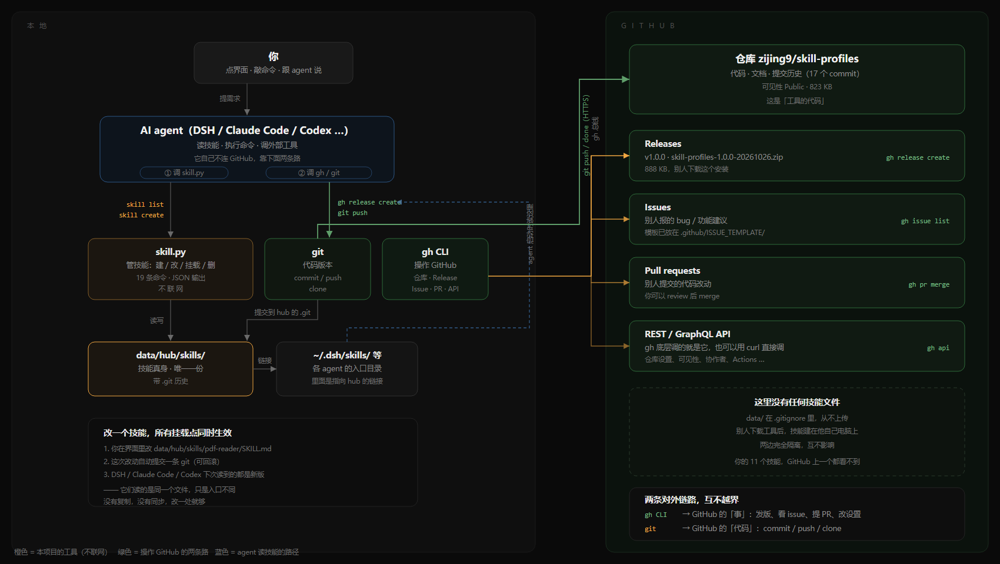

# 功能导图：谁在操作 GitHub

> 一句话：**skill-profiles 只管本地技能，完全不碰 GitHub。**
> 真正操作 GitHub 的是 `gh CLI` 和 `git` 这两条路。



---

## 一、两条对外的链路

| 链路 | 操作 GitHub 的什么 | 用的命令 |
|---|---|---|
| **gh CLI** | 仓库设置、Releases、Issues、Pull requests、任意 API | `gh repo edit` / `gh release create` / `gh issue list` / `gh pr merge` / `gh api` |
| **git** | 代码本身（commit / tree / blob） | `git add` / `git commit` / `git push` / `git clone` |

两者都走 HTTPS，都只碰 GitHub 上的**代码和协作数据**，碰不到你本地的技能。

---

## 二、`gh` 到底操作 GitHub 的哪块

| 命令 | 打到 GitHub 的 | 例子 |
|---|---|---|
| `gh repo edit` | 仓库设置（GraphQL） | 把可见性从 private 改成 public |
| `gh release create` | Releases（REST） | 传 zip 包、写发布说明 |
| `gh issue list` | Issues（REST） | 看别人提了哪些问题 |
| `gh pr merge` | Pull requests（REST） | 合并别人的代码改动 |
| `gh api` | 任意 REST / GraphQL 端点 | 脚本化的一切 |

**底层都是 GitHub 的 HTTP API**。`gh` 只是一个包装：它帮你处理认证（OAuth token）和参数拼装。

---

## 三、`git` 操作的是另一块

```
git push  →  POST /repos/{owner}/{repo}/git/...
             上传 commit 对象、tree 对象、blob 对象
```

它走的是 git 协议（HTTPS 上），推的是**代码的版本历史**，不是 Issue，也不是 Release。

所以：

```
gh release create  ≠  git push
  ↑ 传附件、写说明        ↑ 推代码
```

这两件事互不相干，各用各的通道。

---

## 四、AI agent 是怎么介入的

agent **没有**特殊的 GitHub 权限，它就是：

```
AI agent
  ├─ 读技能：直接读 ~/.dsh/skills/ 下的文件
  ├─ 管技能：调用 cli/skill.py（本地，不联网）
  └─ 操作 GitHub：shell 执行 gh / git 命令
```

所以「agent 对接 GitHub 仓库」的真实链路是：

```
你："把这次的改动发个版本"
  ↓
AI agent 理解意图
  ↓
它执行： git add -A && git commit -m "..." && git push
         gh release create v1.0.1 dist/xxx.zip --notes-file notes.md
  ↓
git 推到仓库的代码区，gh 在 Releases 区创建版本
```

**agent 用的是和你一样的命令行工具，只是它替你敲。**

---

## 五、GitHub 上有什么、没有什么

| 有 | 没有 |
|---|---|
| 工具代码（app.py、cli/、static/） | ❌ 你的技能文件 |
| 文档（README、docs/） | ❌ data/hub |
| 提交历史（17 个 commit） | ❌ 你的配置 |
| Releases（安装包） | ❌ 回收站 |
| Issues / PR | ❌ 各 agent 的目录 |

原因：`data/` 在 `.gitignore` 里，`git` 和 `gh` 都不会碰它。

---

## 六、一句话总结

```
gh   → 管 GitHub 上的「事」    （发版、Issue、PR、设置）
git  → 管 GitHub 上的「代码」  （commit、push、clone）
工具 → 管本地「技能」          （不联网，不上传）
```

三者边界清晰，互不越界。
